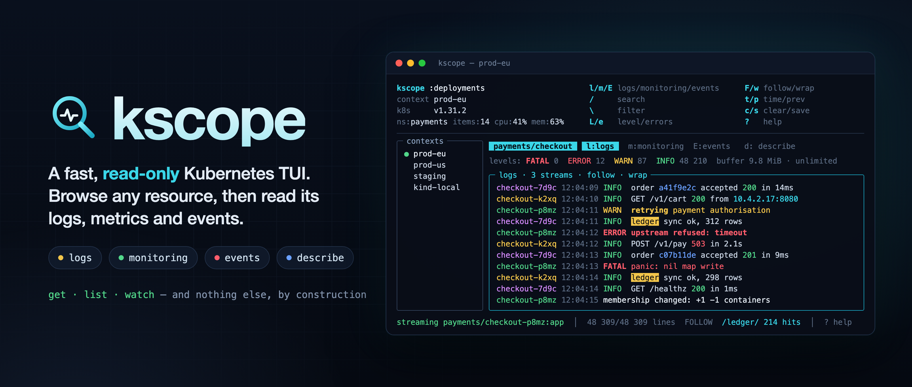
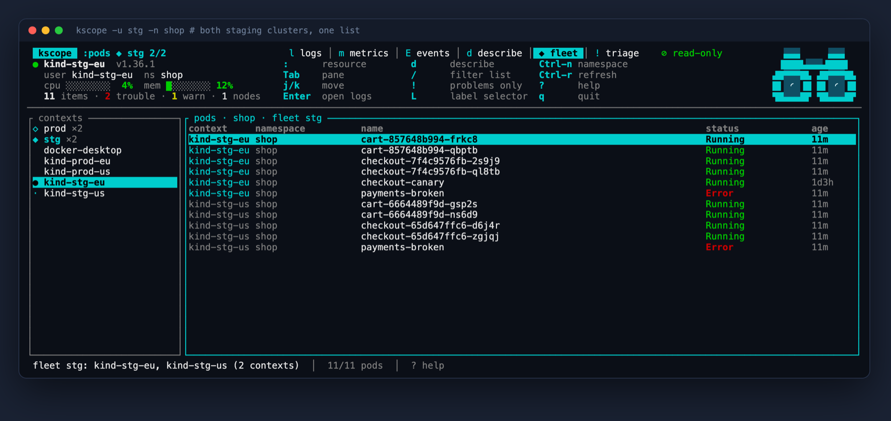
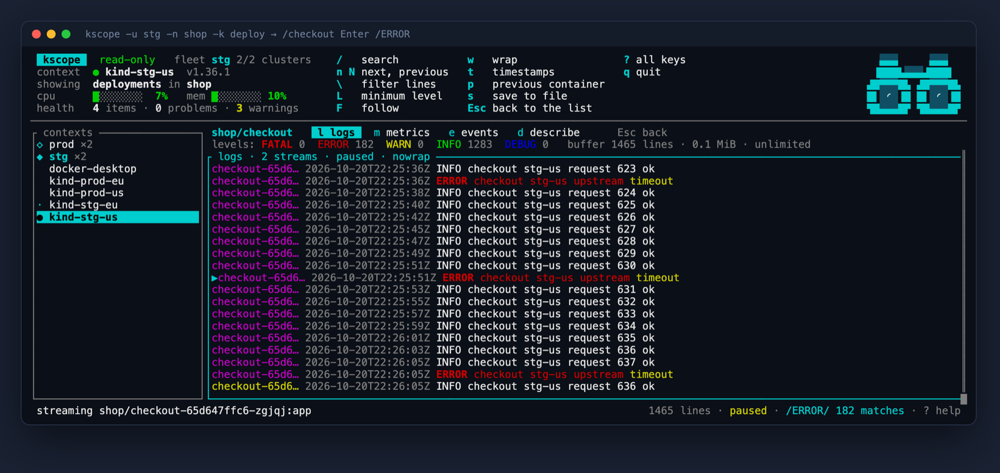
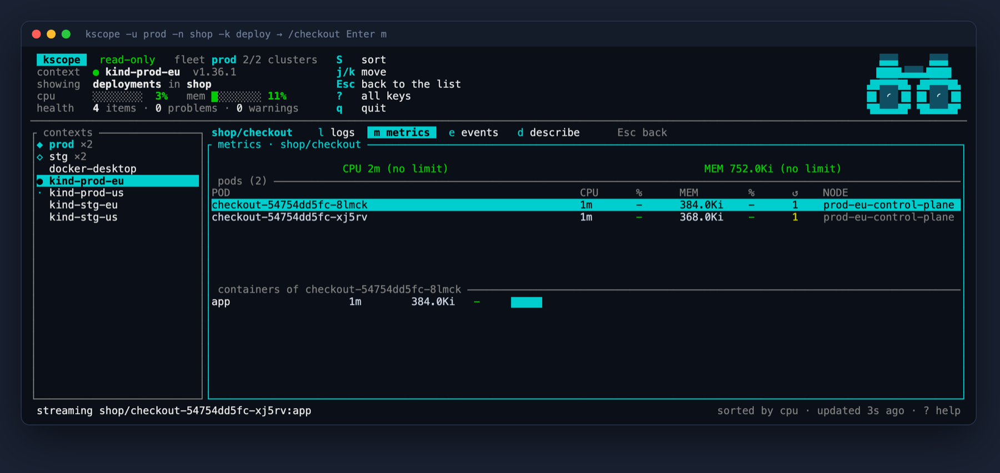

# kscope

**A fast, read-only Kubernetes TUI: browse any resource, then read its logs, metrics and events, on one cluster or across many at once.**

[](https://github.com/hknerts/kscope/actions/workflows/ci.yml)
[](https://github.com/hknerts/kscope/releases/latest)
[](LICENSE)
[](https://www.rust-lang.org)
[](https://github.com/hknerts/kscope/issues?q=is%3Aopen+label%3A%22good+first+issue%22)
[](https://github.com/hknerts/kscope/discussions)

kscope is deliberately **read-only**. There is no editing, scaling, deleting or
shelling in. That is the point: it is safe to hand to anyone holding a view-only
token, it cannot be the cause of an incident, and it stays fast because it never
has to be anything else.


<!-- An animated demo can be regenerated with `make demo` (hack/demo.tape, needs vhs). -->

```sh
curl -sSfL https://github.com/hknerts/kscope/releases/latest/download/kscope-x86_64-unknown-linux-gnu.tar.gz | tar xz && sudo install kscope /usr/local/bin/
cargo install --locked --git https://github.com/hknerts/kscope      # any platform, Rust 1.89+
docker run --rm -it -v ~/.kube:/home/nonroot/.kube:ro ghcr.io/hknerts/kscope:latest
```

macOS (Intel and Apple Silicon), Linux arm64 and Windows archives: see [Install](#install).
Then run `kscope`, or `kscope -u stg` to browse every staging cluster as one.

<table>
  <tr>
    <td colspan="2"></td>
  </tr>
  <tr>
    <td width="50%"></td>
    <td width="50%"></td>
  </tr>
  <tr>
    <td colspan="2" align="center"><sub>Real screens. <code>kscope -u stg -n shop</code> lists both staging clusters as one.
    <code>Enter</code> on a deployment merges its replicas' logs, wherever they run. <code>m</code> shows what they use.</sub></td>
  </tr>
</table>

**Contents:** [How it works](#how-it-works) · [Why](#why) ·
[kscope or k9s?](#kscope-or-k9s) · [Install](#install) · [Usage](#usage) ·
[Key bindings](#key-bindings) · [Fleets](#fleets-many-clusters-as-one) ·
[Configuration](#configuration) · [Permissions](#permissions) ·
[Contributing](#contributing)

## How it works

Two panes, and one key that drives everything:

```
┌─ contexts ─┐┌─ pods · payments ───────────────────────────┐
│ ● prod-eu  ││ namespace  name              status    age  │
│   prod-us  ││ payments   checkout-7d9c     Running   4h   │
│   staging  ││ payments   ledger-58f4       0/1       12m  │
└────────────┘└─────────────────────────────────────────────┘
                             Enter ↓
┌─ contexts ─┐┌ payments/ledger-58f4   l logs  m metrics  e events  d describe ┐
│ ● prod-eu  ││ 12:04:11  WARN  retrying payment authorisation                  │
└────────────┘└─────────────────────────────────────────────────────────────────┘
```

* **`:` picks the resource type**, with k9s-style autocompletion — `:po`,
  `:deploy`, `:pvc`, `:no`, or fuzzy input like `:dpy`. The candidate list comes
  from the cluster's own discovery API, so **CRDs complete exactly like built-in
  kinds** and a kind your cluster does not serve is never offered.
* **The left pane lists your kubeconfig contexts.** `Enter` switches cluster in
  place — the client is rebuilt and every poller restarts, without restarting
  kscope.
* **`Enter` opens an object's logs**, `m` its metrics, `e` its events, and
  `d` describes it in the same pane. `Esc` steps back out. Everything is scoped to
  what you opened: a Deployment streams all its replicas *and* totals their CPU
  and memory, a Service follows what it selects, a Node shows its kubelet
  journal and what is scheduled on it.

## Why

Reading logs through `kubectl logs -f` works until you need to page back, grep,
follow three containers at once, or notice that the pod you are debugging is
being OOM-throttled — and then you still have to run `kubectl describe` in
another terminal to find out why it will not start. kscope keeps all of it on
one screen:

* **Logs** — open a *workload*, not a pod: every replica of a Deployment merges
  into one timeline, and a rollout hands the stream over to the new pods instead
  of going quiet on the old ones. Plus paging, regex search with match
  highlighting, level filtering, automatic error highlighting, export to file.
* **Monitoring** — scoped to the object in hand, not a cluster-wide table: a
  Deployment totals its replicas, a pod breaks down by container with rolling
  sparklines, a node shows its own load and what is scheduled on it, and a
  claim shows **how full it actually is** — a figure the Kubernetes API does not
  carry at all.
* **Events** — scoped to the object you have open, warnings separable with one
  key, so "why is this pending?" is one `e` away.
* **Only problems** — `!` narrows any listing to just the objects in trouble, reading
  the real container state rather than the phase: a pod stuck in
  `CrashLoopBackOff` still reports phase `Running`, and that is exactly the one
  you need to find.
* **Fleets** — an environment is rarely one cluster. `stg` and `prod` are
  built in, more come from the config or `KSCOPE_FLEET_<NAME>`, and every
  listing spans all members at once,
  tagged with the cluster each row came from. `Enter` on a workload merges
  its logs from **every cluster** it runs on, and `a` lines it up across
  them with the drift flagged: which cluster runs another image, other
  replicas, or a spec that differs, down to the field.
  See [Fleets: many clusters as one](#fleets-many-clusters-as-one).
* **The list says what runs** — pods, workloads and Services show their live
  CPU and memory (the sum over their pods; `-` without metrics-server) and
  their images as `name:version`, without the registry prefix.

## kscope or k9s?

[k9s](https://github.com/derailed/k9s) is a cockpit: you go there to *act* —
scale, delete, edit, port-forward, exec. kscope is an instrument panel: you go
there to *understand*. It is not a replacement, and plenty of teams want both.

The difference you feel day to day is **who you can hand it to**. k9s's
`--readonly` is a runtime flag — the capability is still compiled in and the flag
can be dropped. kscope has no mutating code at all: point it at a cluster with an
admin kubeconfig and it still cannot scale, delete, patch or exec, because none
of those calls exist in the binary.

So it costs nothing to give away. On-call, juniors, contractors and auditors can
all dig through production logs, container memory trends and events without
anyone vetting what else their token permits — which means looking happens
earlier. A container creeping toward its memory limit, restarts climbing on one
replica, a repeating `FailedScheduling`: visible before they become an outage.
kscope will not stop a bad deploy; it shortens the gap between something breaking
and somebody noticing.

The second difference is **how many clusters you see at once**. k9s shows one
context at a time: `:ctx` switches, and there is no list that spans clusters.
kscope has [fleets](#fleets-many-clusters-as-one): one list across every
cluster of an environment, with a `context` column.

| | k9s | kscope |
| --- | --- | --- |
| Clusters in one view | one context at a time | a whole fleet (`-u stg`) |
| Search across clusters | switch with `:ctx` and search each one | `/checkout` filters every member at once |
| Logs of a workload on several clusters | one cluster at a time | `Enter` merges every cluster's replicas, each line labelled |
| Drift between clusters | compare by hand | `a`: images, replicas and spec side by side, the odd one flagged |
| Environment groups | none | `stg` and `prod` built in, more via `[fleets]` or `KSCOPE_FLEET_<NAME>` |
| One-shot listing | none (it is TUI only) | `kscope get pods -u prod`, with `CONTEXT`, `CPU`, `MEMORY` and `IMAGE` |
| A cluster that is down | that context fails | reported in the header; the others still list |

## Install

### Release binaries

Every [release](https://github.com/hknerts/kscope/releases) attaches an archive
and a `.sha256` for each target:

| Platform | Archive |
| --- | --- |
| Linux x86_64 | `kscope-x86_64-unknown-linux-gnu.tar.gz` |
| Linux arm64 | `kscope-aarch64-unknown-linux-gnu.tar.gz` |
| macOS Apple Silicon | `kscope-aarch64-apple-darwin.tar.gz` |
| macOS Intel | `kscope-x86_64-apple-darwin.tar.gz` |
| Windows x86_64 | `kscope-x86_64-pc-windows-msvc.zip` |

```sh
target=aarch64-apple-darwin   # one of the names above
curl -sSfLO https://github.com/hknerts/kscope/releases/latest/download/kscope-$target.tar.gz
curl -sSfLO https://github.com/hknerts/kscope/releases/latest/download/kscope-$target.tar.gz.sha256
shasum -a 256 -c kscope-$target.tar.gz.sha256
tar xzf kscope-$target.tar.gz && sudo install kscope /usr/local/bin/
```

On macOS, a binary downloaded with a browser rather than `curl` is
quarantined; `xattr -d com.apple.quarantine kscope` clears it.

### From source

```sh
cargo install --locked --git https://github.com/hknerts/kscope
```

### Container

```sh
docker run --rm -it -v ~/.kube:/home/nonroot/.kube:ro ghcr.io/hknerts/kscope:latest
```

## Usage

```sh
kscope                        # current context, current namespace
                              # (log history from container start, last 50k lines kept)
kscope -n payments            # a specific namespace
kscope -A                     # every namespace you can read
kscope --context staging      # start on a specific kubeconfig context
kscope -l app=api,tier!=batch # only objects matching a label selector
kscope --tail 2000            # only the last 2000 log lines instead of everything
kscope --buffer 200000        # keep 200k lines instead of 50k (0 = unlimited)
kscope --since 3600           # only lines from the last hour
kscope --dump checkout-7d9c:app > app.log   # non-interactive, for scripts
kscope -u stg                 # every context with "stg" in its name, as one list
kscope get pods -u stg        # kubectl-style: list them across all of those clusters
kscope get deploy checkout -u prod -n shop   # filter by name and namespace
```

## Key bindings

### Everywhere

| Key | Action |
| --- | --- |
| `:` | pick a resource type (autocompleting) |
| `Tab` | move focus between contexts and resources |
| `Esc` | leave the detail view; from the list, quit |
| `q`, `Ctrl-c` | quit |
| `?` | help overlay |
| `j` `k` `↑` `↓` | move one row or line |
| `←` `→`, `PgUp` `PgDn` | page up / down |
| `Ctrl-u` / `Ctrl-d` | half page up / down |
| `Ctrl-b` / `Ctrl-f` | full page up / down |
| `g` / `G` | top / bottom (bottom re-enables follow) |
| `Ctrl-n` | change the namespace scope |
| `M` | toggle mouse capture: off lets the terminal select and copy text, on scrolls with the wheel |

### In the `:` palette

| Key | Action |
| --- | --- |
| *type* | filter candidates live (prefix, substring or fuzzy) |
| `Tab` | accept the highlighted completion, or cycle matches |
| `↑` `↓` | move through the completions |
| `Enter` | apply |
| `Esc` | cancel |

`:fleet stg` (or `:u stg`) switches fleet from anywhere, the list or any tab,
with the same rules as `-u`: a fleet name, a plain word matching every
context that contains it, or globs (`:fleet stg-*,qa-eu`). After `:fleet ` the
completions are the configured fleets. `:fleet` alone leaves the fleet.

### Resource list

| Key | Action |
| --- | --- |
| `Enter`, `l` | open the object's logs (a workload: all its pods; a fleet: all its clusters) |
| `m` / `e` | open its metrics / events |
| `d` | describe it: a tab like `l` `m` `e`, which lead straight on from it |
| `a` | in a fleet: the object on every cluster, drift flagged |
| `/` | filter the list by name or namespace |
| `S` | cycle sort: name → age (newest first) → status (problems first) → restarts (pods, most first) |
| `!` | only problems: crash loops, pending, not ready, failed (again to show all) |
| `L` | set a label selector |
| `Ctrl-r` | re-list now |

### Contexts pane

| Key | Action |
| --- | --- |
| `Enter` | on a context: switch to that cluster (and leave any fleet) |
| `Enter` | on a fleet (`◇`): list every member at once |
| `/` | browse an ad-hoc fleet: context globs, e.g. `stg-*,qa-eu` |

### Detail — `l` logs

| Key | Action |
| --- | --- |
| `/` then `n` / `N` | regex search, next / previous match |
| `\` | filter lines; prefix with `!` to exclude |
| `L` | minimum level: all → DEBUG → INFO → WARN → ERROR → FATAL |
| `l` / `m` / `e` | switch to logs / metrics / events |
| `F` / `w` | toggle follow / wrapping |
| `t` / `p` | toggle timestamps / previous (crashed) container |
| `c` / `s` | clear buffer / save visible buffer to a file in `logs.save_dir` |
| `[` `]` | horizontal scroll when wrapping is off |
| `x` | detach all streams |
| `v` | on a Node: cycle kubelet / containerd / kernel |

### Detail — `m` metrics, `e` events, `d` describe

| Key | Action |
| --- | --- |
| `S` | cycle sort: name / cpu / memory |
| `W` | events: warnings only |
| `j` `k` `g` `G` | scroll the describe view |
| `v` | describe of a Secret: show its values decoded, or hide them again |

`d` renders the object as YAML — every kind, CRDs included — with the noise
`kubectl` also hides stripped out: managed fields, resource versions and the
`last-applied-configuration` annotation. It opens in the right pane, where
the list or the open tab was, and works straight from the list without
opening the object first.

**Secret values are redacted**: a Secret shows its keys as
`<redacted, N bytes>`, so you can check that a key exists and is not empty
without reading it — even when kscope runs with a token that could. `v` shows
the values **decoded** (`password: hunter2`, not base64) and hides them again;
moving to another object hides them too. Binary values are named
(`<binary, 2048 bytes>`), not printed. To hand kscope to people who must never
see them, set `describe.allow_reveal = false`; to always show them,
`describe.show_secret_values = true`.

> The logs tab resolves whatever you opened down to pods: a Deployment,
> StatefulSet, DaemonSet, Job or ReplicaSet through its replicas, a Service or
> CRD through its `spec.selector`, a Namespace or Node through everything running
> there. Kinds with nothing behind them (a ConfigMap, say) say so. `logs.max_streams`
> caps how many containers are streamed at once — see [Configuration](#configuration).

## Fleets: many clusters as one

Say staging is five clusters and you want to know where `checkout` is running,
or which of them has a pod in trouble:

```sh
kscope get pods -u stg            # list, kubectl-style, and exit
kscope -u stg                     # or browse them in the TUI and open what you find
```

`-u` (`--fleet`) takes a word, a glob or a fleet name. A plain word such as
`qa` selects every kubeconfig context whose name contains it. It means one
context only when a context has exactly that name. `stg-*,qa-eu` are globs.

### Setting up fleets

Two fleets are built in, so most setups need no configuration at all:

| Fleet | Matches contexts named like |
| --- | --- |
| `stg` | `*stg*`, `*staging*` |
| `prod` | `*prod*`, `*prd*`, `*pro*` |

Each source below overrides the one above it for the same fleet name, and
fleets with other names are added alongside:

1. **Built in**: `stg` and `prod` as above.
2. **Config file**, under `[fleets]` (see [Configuration](#configuration) for
   where it lives):

   ```toml
   [fleets]
   stg     = ["kind-stg-*"]               # replaces the built-in stg
   prod    = ["prod-eu-*", "prod-us-1"]
   qa      = ["qa-*"]                     # a fleet of your own
   ```

3. **Environment**, which wins when it is set. `KSCOPE_FLEET_<NAME>` holds
   comma-separated globs. The name is lower-cased:

   ```sh
   export KSCOPE_FLEET_STG="stg-eu-*,stg-us-1"   # fleet "stg", over the file
   export KSCOPE_FLEET_EDGE="edge-*"             # fleet "edge"
   export KSCOPE_FLEET_PROD=""                   # switch prod off
   ```

An empty list (`prod = []`) or an empty variable switches a fleet off.
`KSCOPE_FLEET` (with no suffix) is different: it is the same as `-u` and picks
the fleet to start on.

A fleet appears in the `fleets` box above the `contexts` box, marked `◇`, when
at least one context matches it. One cursor runs over both boxes: `↑`/`↓`
move from the last fleet straight onto the first context. kscope does not invent other groups from context names. A
set that is not configured is still one `-u qa` or one `/` on the pane away.
`Enter` on a fleet (or `kscope -u stg`) lists the current kind on **every
member at once**, with a `context` column:

```
┌ fleets ────────┐┌ pods /checkout/ · all · fleet stg ──────────────────────┐
│◇ prod ×2       ││context      namespace  name                   status    │
│◆ stg ×5        ││stg-eu-1     shop       checkout-b9d96-nfps9   Running   │
└────────────────┘│stg-eu-1     shop       checkout-canary        Running   │
┌ contexts ──────┐│stg-us-2     shop       checkout-84757-ffk7f   Running   │
│  prod-eu-1     ││stg-us-2     shop       payments-broken        CrashLoop │
│· stg-eu-1      ││                                                         │
│● stg-us-2      ││                                                         │
└────────────────┘└─────────────────────────────────────────────────────────┘
```

* **Search**: `/` filters by name, namespace *or* context across every member;
  `:deploy`, `!` and `L` work exactly as on one cluster.
* **Logs from every cluster**: `Enter` (or `l`) on a workload streams its
  pods on **every member that has it**, merged into one timeline. Each line
  starts with its cluster, and the title says how much is merged
  (`logs · 4 pods merged from 2 of 2 clusters`). A rollout on any member
  hands over to the new pods within 15 seconds. No context switch happens.
* **Compare (`a`)**: the object as each member has it, side by side:
  status, replicas, images, and whether the spec is the same. Whatever
  differs from most members is flagged, down to the field:

  ```
   ≠ replicas differ on stg-us   spec differs on stg-us (template.spec.containers[0].image)
  CLUSTER   STATUS  REPLICAS  SPEC     IMAGES
  stg-eu    2/2     2         same     checkout:2.4.1
  stg-us    3/3     3         differs  checkout:2.3.0
  stg-ap    —                          not on this cluster
  ```

  ConfigMaps and Secrets compare their data (only whether it differs is
  shown, never a value). A `rollout restart` is not counted as drift.
* **Open elsewhere**: `m`, `e` or `d` on a row from another cluster switch
  kscope to that cluster and open the object there. `Esc` brings you back
  to the fleet-wide list, still filtered.
* **Ad hoc**: no config needed. `/` on the contexts pane, or `:fleet` from
  anywhere, takes the same words and globs as `-u`.
* **Leave**: pick a single context in the pane, or `:fleet` with no name.

A fleet lists across all namespaces unless `-n` is given (narrow it later with
`Ctrl-n`). Members are queried concurrently, and each gets 10 seconds to
answer. An unreachable cluster is reported in the status bar and the header
(`◆ stg 4/5`). It never blocks the rest. kscope starts on your current context
if it is a member, otherwise on the first member that answers.

Without the TUI, `kscope get KIND [NAME] -u FLEET` prints the matches and
exits, like `kubectl get` with a `CONTEXT` column. `NAME` is a substring of the
name or namespace. `-n` and `-l` narrow the search the same way as in kubectl:

```console
$ kscope get deploy -u stg -n shop
CONTEXT      NAMESPACE  NAME      STATUS  CPU  MEMORY   AGE   IMAGE
kind-stg-eu  shop       cart      2/2     2m   656.0Ki  2d2h  busybox:1.36
kind-stg-eu  shop       checkout  2/2     2m   1.2Mi    2d2h  busybox:1.36
kind-stg-us  shop       cart      2/2     2m   648.0Ki  2d2h  busybox:1.36
kind-stg-us  shop       checkout  2/2     2m   680.0Ki  2d2h  busybox:1.36

$ kscope get sts -u prod -n data
```

`CPU` and `MEMORY` are current usage from metrics-server: a pod's own, a
workload's or Service's summed over its pods, `-` when a cluster has no
metrics-server or a pod is not running. `IMAGE` is `name:version` without the
registry. Kinds that run no pods (ConfigMaps, say) get neither column.

For scripts, `-o json` prints a JSON array of
`{context, namespace, name, status, age_seconds}` (`[]` when nothing matches),
and `-o name` prints `context/namespace/name`, one per line. The namespace is
empty for cluster-scoped kinds (`kind-stg-eu//worker`):

```console
$ kscope get pods -u stg -o json | jq -r '.[] | select(.status != "Running") | .name'
$ kscope get deploy -u stg -n shop -o name
kind-stg-eu/shop/cart
kind-stg-eu/shop/checkout
kind-stg-us/shop/cart
kind-stg-us/shop/checkout
```

`get` exits 0 even when nothing matches, as kubectl does. For grep-style exit
codes use `--find TEXT -k KIND`, which exits 1 when nothing matches.

Every member uses the credentials of its own kubeconfig context, and the
[read-only guarantee](#permissions) holds for each of them.

## How far back can I scroll?

By default, **the last 50 000 lines**, filled from the container's first line:

* On attach, kscope asks the API server for the container's entire retained
  history (`tail_lines` unset), not a fixed tail.
* The in-memory buffer is a **ring of 50 000 lines** by default
  (`logs.buffer_lines`), about 12 MiB at a typical 200-byte line, so a noisy
  pod or a fleet-wide merge cannot grow memory without limit. Once it is full
  the oldest lines are evicted, and the log pane says how many
  (`buffer 50000/50000 · 1200 evicted, oldest first`).
* `logs.buffer_lines = 0` (or `--buffer 0`) makes it **unbounded**: nothing is
  evicted for the lifetime of the session, and `g` always jumps to the first
  line. The log pane then shows the live line count and resident size, so the
  session cannot grow silently.

Two limits are outside kscope's control, and it is worth knowing them:

1. **Kubelet log rotation.** The API server can only return what is still on the
   node. Kubelet rotates container logs at `containerLogMaxSize` (10 MiB by
   default) and keeps `containerLogMaxFiles` (5 by default) of them. Anything
   older is gone before any tool can read it — `kubectl logs` has the same
   ceiling. For genuinely permanent history you need a log shipper.
2. **Container restarts.** A restart starts a fresh log. Press `p` to read the
   previous, crashed instance instead.

Events have a third: the API server **expires them after about an hour**
(`--event-ttl`). An empty events tab usually means "nothing has happened
recently", not that something is broken.

To keep more history, raise the cap or remove it; to fetch less, narrow the
tail:

```toml
[logs]
buffer_lines = 200000   # a bigger ring; 0 = unlimited, never evict
tail_lines = 5000       # only fetch the last 5000 lines on attach
```

## Configuration

kscope runs with zero configuration. To customise it, drop a `config.toml`
(see [`examples/config.toml`](examples/config.toml)) in the platform's config
directory, or pass `-c FILE` / set `KSCOPE_CONFIG`:

| OS | Path |
| --- | --- |
| Linux | `~/.config/kscope/config.toml` (or `$XDG_CONFIG_HOME/kscope/`) |
| macOS | `~/Library/Application Support/io.kscope.kscope/config.toml` |
| Windows | `%APPDATA%\kscope\kscope\config\config.toml` |

`s` saves the visible log buffer as `kscope-YYYYMMDD-HHMMSS.log` in
`logs.save_dir`, by default the platform data directory
(`~/.local/share/kscope` on Linux, `~/Library/Application Support/io.kscope.kscope`
on macOS, `%APPDATA%\kscope\kscope\data` on Windows), never the directory
kscope was started from. The status bar shows the full path written.


```toml
[general]
inventory_refresh_ms = 5000
events_refresh_ms = 10000
max_fps = 30

[describe]
show_secret_values = false   # Secrets render as <redacted, N bytes>
allow_reveal = true          # v shows a Secret's values decoded; false forbids it

[fleets]                     # contexts browsed as one, by glob; stg and prod
qa = ["qa-*"]                # are built in, KSCOPE_FLEET_<NAME> overrides

[logs]
buffer_lines = 50000 # ring buffer (default); 0 = unlimited, never evict
tail_lines = 0       # 0 = everything the API server still has (default)
smart_case = true
max_streams = 50     # cap on concurrent container log streams
# save_dir = "~/kscope-logs"   # where s saves; default: the platform data dir

[metrics]
refresh_ms = 5000
history = 240
warn_pct = 75.0
critical_pct = 90.0

[[highlight]]
pattern = 'order_id=[0-9a-f]+'
fg = "#ff8800"
bold = true
```

## Permissions

kscope only ever performs `get`, `list` and `watch` — there is no code path that
writes. Because `:` browses whatever the cluster serves, how much you can see
follows directly from what your token may list.

A role covering the built-in views:

```yaml
apiVersion: rbac.authorization.k8s.io/v1
kind: ClusterRole
metadata:
  name: kscope-viewer
rules:
  - apiGroups: [""]
    resources: ["pods", "pods/log", "nodes", "namespaces", "events",
                "persistentvolumeclaims", "services", "configmaps"]
    verbs: ["get", "list", "watch"]
  - apiGroups: ["apps"]
    resources: ["deployments", "statefulsets", "daemonsets", "replicasets"]
    verbs: ["get", "list", "watch"]
  - apiGroups: ["metrics.k8s.io"]
    resources: ["pods", "nodes"]
    verbs: ["get", "list"]
```

For the full experience — every kind the palette can offer, CRDs included — bind
the built-in `view` ClusterRole instead. Everything degrades gracefully: a kind
you cannot list reports the error in the pane it belongs to and leaves the rest
of the tool working.

Node journals (`v` on an open Node) and live PVC usage are the two things `view`
does not cover. Both read the kubelet through the same subresource, and are
worth granting deliberately rather than by default:

```yaml
  - apiGroups: [""]
    resources: ["nodes/proxy"]
    verbs: ["get"]
```

**Node journals** additionally need Kubernetes 1.27+ with the `NodeLogQuery`
feature gate and kubelet's `enableSystemLogHandler` and `enableSystemLogQuery`
both enabled. Without them kubelet quietly serves a `/var/log` directory index
instead; kscope detects that and says so rather than showing you HTML.

**PVC usage** comes from kubelet's `stats/summary`, so it only exists for volume
plugins that report metrics. Most CSI drivers do; `hostPath` and the
`local-path` provisioner used by kind and minikube do not, and there the column
reads `-` with the reason in the panel title.

## Performance notes

The design targets pods that emit tens of thousands of lines per second:

* Log lines arrive in **batches** (512 lines or 100 ms) so a chatty container
  cannot livelock the render loop.
* Lines are classified into a severity level exactly once, on arrival, and
  stored in a fixed-capacity ring buffer (`logs.buffer_lines`, 50 000 by
  default), or an unbounded deque with `buffer_lines = 0`.
* The filtered view is a list of line ids maintained **incrementally**; only a
  filter change costs a full pass.
* Redraws are capped at `general.max_fps` (30 by default) and only happen when
  something actually changed.
* **Only the visible window is styled** — cost per frame is independent of how
  many lines are in the buffer.
* Pods, nodes, PVCs, namespaces and events are **watched**, not re-listed: one
  paginated LIST on start, then only the changes. A quiet cluster costs next
  to nothing, and a pod going `CrashLoopBackOff` shows up in under a second.
* A log stream that drops reconnects **from the last line it delivered**
  (`sinceTime`, then de-duplicated by timestamp) instead of replaying the
  container's whole history into the buffer — and a finished container is not
  re-polled twice a second.
* A log batch is flushed 100 ms after its *first* line, so a steady trickle is
  never held back waiting for 512 lines to pile up.
* Search hit counts, the buffer's memory figure and table rendering are all
  incremental or windowed: no per-frame or per-batch pass over the buffer or
  the whole list.
* Discovery uses the aggregated discovery API (two requests, Kubernetes 1.26+)
  and falls back to the per-group walk on older clusters. Discovery, listings,
  the version probe and context switches all run off the UI task, so a slow
  API server or an exec credential plugin never freezes the interface.
* An idle kscope does not redraw or wake up on a frame timer.
* Release builds use fat LTO and a single codegen unit.

## Requirements

* A reachable cluster (kubeconfig or in-cluster service account).
* [metrics-server](https://github.com/kubernetes-sigs/metrics-server) for the
  metrics tab. Without it, everything else still works and the metrics pane
  explains what is missing.

## Contributing

kscope is small enough to understand in an afternoon, and there is plenty to
build. You can go from clone to a four-cluster playground in five minutes:

```sh
git clone https://github.com/hknerts/kscope && cd kscope
make dev-up            # 4 local kind clusters with workloads that log and crash
cargo run -- -u stg    # you are now browsing two clusters at once
```

* **Pick something:** the [good first issues](https://github.com/hknerts/kscope/issues?q=is%3Aopen+label%3A%22good+first+issue%22)
  each say why the change matters, which file to start in, and when it counts
  as done. [Help wanted](https://github.com/hknerts/kscope/issues?q=is%3Aopen+label%3A%22help+wanted%22)
  has bigger ones: CronJob logs, kubectl's server-side columns, Homebrew and
  krew packages.
* **Ask anything** in [Discussions](https://github.com/hknerts/kscope/discussions),
  including half-formed ideas.
* **How it fits together:** [CONTRIBUTING.md](CONTRIBUTING.md) has a map of the
  code and shows how to test state, rendering and real clusters.
  [ARCHITECTURE.md](docs/ARCHITECTURE.md) explains why it is built this way.

The one rule is that kscope stays read-only. Everyone taking part is expected to
follow the [Code of Conduct](CODE_OF_CONDUCT.md). Getting help:
[SUPPORT.md](SUPPORT.md); who decides what: [MAINTAINERS.md](MAINTAINERS.md).

## License

Released under the [MIT License](LICENSE).
